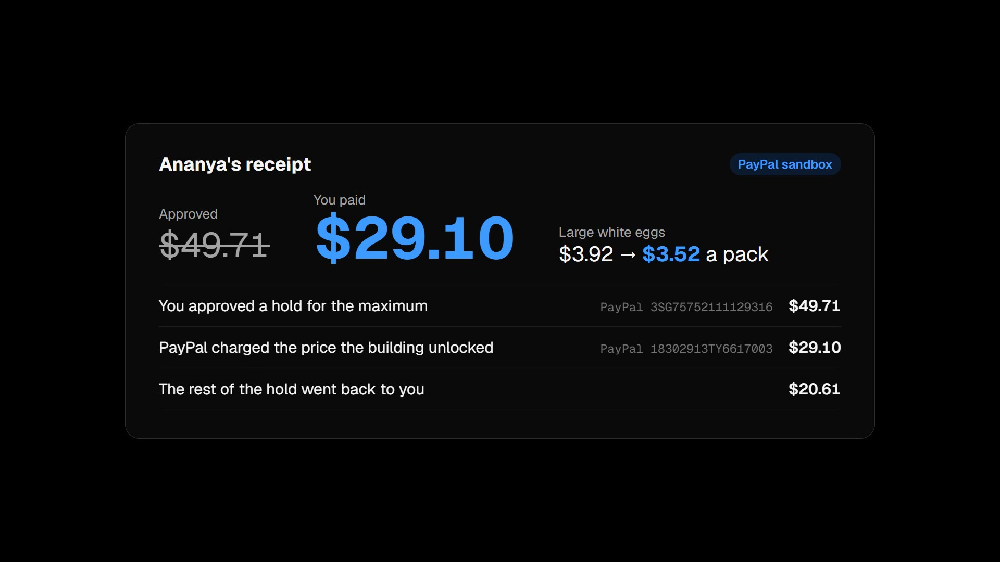
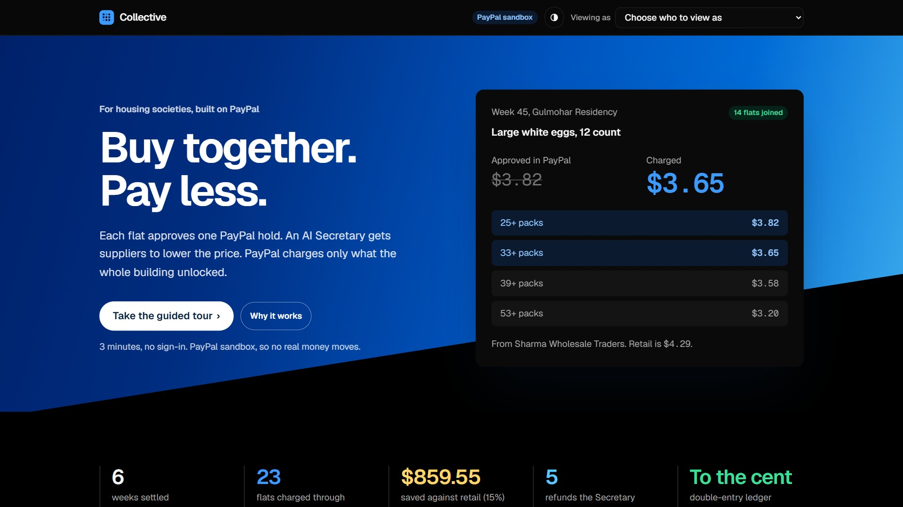
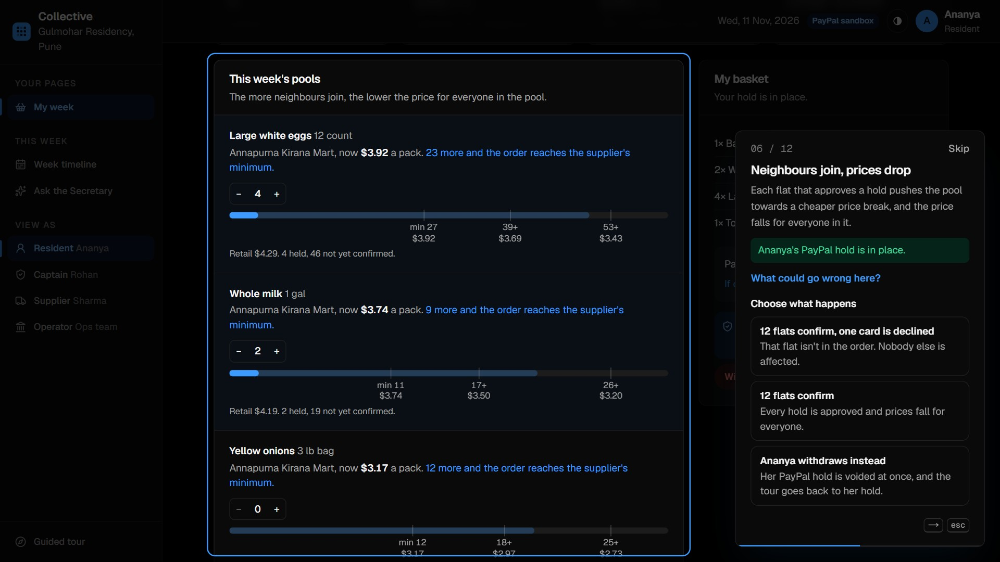
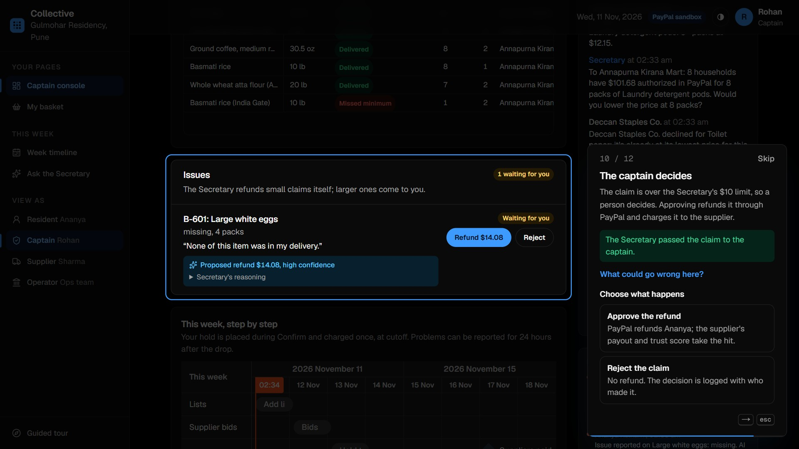
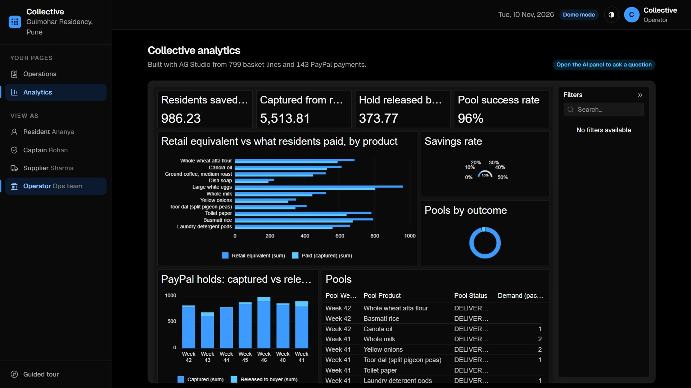
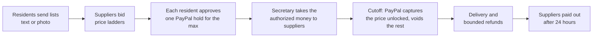

# Collective

**Your housing society buys groceries in bulk, together.** Each resident approves one PayPal hold for the most they'd pay. An AI Society Secretary gets trusted local suppliers to compete, then goes back to them with the money already approved to push prices lower. At cutoff, PayPal charges only the price the whole building unlocked.

[](brag-output-2026-11-11-023203/brag.mp4)

*Eggs approved at $3.92 a pack, charged at $3.52, the rest of the hold released.* Both videos are recorded from one real PayPal sandbox run, and every PayPal ID on screen is one the sandbox returned. Above: a 29-second launch film. The [2-minute demo](brag-output/demo.mp4) walks the whole guided tour in the real app.

| | |
|---|---|
|  |  |
|  |  |

**Try it:** https://collective-mxtv.onrender.com (free server: the first visit can take about a minute to wake). Press **Take the guided tour**.

Built for the PayPal AI Hackathon. PayPal sandbox only: no real money moves.

<!-- Add before submitting: hosted demo URL, YouTube video link, and an "Evidence from a real building" section. -->

## The problem

Forty flats in a society buy the same rice, dal, oil and eggs every week, one by one, at retail. Wholesalers charge 10 to 30% less, but only above a minimum order no single flat reaches. Today a volunteer pools orders in a group chat: collects lists, chases payments, haggles, and fronts the money. That stops working at about fifteen households, and the volunteer carries the risk.

Collective does the volunteer's job with an AI agent, and makes PayPal carry the money risk instead of a neighbour.

## How a week works



| Step | What happens | AI | PayPal |
|---|---|---|---|
| 1. Collect | Residents type a list or photograph a handwritten one | Basket Assistant (Gemini vision) turns it into products and blocks restricted items; Channel3 matches unknown items | |
| 2. Bid | Each product becomes a pool. Suppliers see totals only and bid a ladder of prices that drop as the order grows | Bids are scored in code (price 40, trust 45, reachable minimum 15); the AI explains the ranking | |
| 3. Confirm | Each resident approves **one hold for the highest price** their items could cost. Neighbours join and the price falls for everyone | The **Society Secretary** takes the authorized dollars to each supplier and asks for a lower price at that quantity | Orders v2 `intent=AUTHORIZE`, then authorize |
| 4. Cutoff | Pools that reached their minimum succeed; each hold is charged at the final price | | Partial capture with `final_capture: true`; void when nothing succeeded |
| 5. Delivery | The captain checks the drop. Residents report problems with a photo | The Secretary refunds plausible claims up to $10 itself; larger or doubtful ones go to the captain | Refunds |
| 6. Payout | After 24 hours, suppliers are paid minus commission and refunds | | Payouts; Subscriptions for supplier plans; webhooks |

**The rule residents see:** you never pay more than you approved, and you usually pay less.

## Three ideas that make it different

1. **The PayPal hold is the agent's budget.** A spending limit written into a prompt is only a suggestion. Here the limit is an authorization PayPal enforces: the platform cannot capture more than each resident approved, whatever any agent decides.
2. **Money on the table.** A group chat can only say "we'd like a discount". The Secretary can say "19 households have $168 authorized in PayPal for 43 packs of eggs; will you lower the price at 43?" A supplier may add a cheaper price break, never below its own floor, and the first price (what every hold was sized on) never changes, so every charge still fits its hold.
3. **Trust beats cheap.** Each supplier's trust score comes from facts the system verifies itself: lines delivered and complaints upheld, smoothed so two good orders don't outrank two hundred, and weighted to recent weeks. The captain sees lines like *"Recommend Annapurna Kirana Mart despite costing $0.52 more per pack than Deccan Staples Co.: trust 88/100 against 65/100."*

## Who may do what

| Action | Who | Limit enforced in code |
|---|---|---|
| Read lists, match products, rank bids, explain | AI | Output is schema-checked; scores are computed in code |
| Ask suppliers for a better price | Society Secretary | Prices can only fall; never below the supplier's floor; first price fixed |
| Refund a delivery problem | Society Secretary | At most $10, never more than was charged for the item, one refund per issue, at most 3 automatic refunds per household in 30 days |
| Larger refunds, rejected claims | Captain | Human decision |
| Approve a hold | Resident | Explicit PayPal approval (or the sandbox test card) |
| Capture, void, pay out | Settlement engine only | Capture never exceeds the hold; the double-entry ledger must balance |

No agent has a capture, void or payout tool. Every AI decision is logged with the model that made it.

## PayPal integration

Orders and Payments calls go through PayPal's official Server SDK ([`@paypal/paypal-server-sdk`](https://www.npmjs.com/package/@paypal/paypal-server-sdk), generated by APIMatic). Payouts and webhook verification, which the SDK doesn't cover, use REST.

| Capability | API | Where |
|---|---|---|
| Hold the maximum | `OrdersController.createOrder` with `intent: AUTHORIZE`, then `authorizeOrder` | `lib/paypal/gateway.ts`, `lib/engine/basket.ts` |
| Charge the unlocked price | `PaymentsController.captureAuthorizedPayment` with `finalCapture: true` | `lib/engine/settlement.ts` |
| Release a failed pool | `PaymentsController.voidPayment` | `lib/engine/settlement.ts` |
| Check a hold | `PaymentsController.getAuthorizedPayment` ("Check this with PayPal" on the receipt) | `app/actions.ts` |
| Refund a problem | `PaymentsController.refundCapturedPayment` | `lib/engine/refunds.ts` |
| Pay suppliers | `POST /v1/payments/payouts`, `GET /v1/payments/payouts/{batch}` | `lib/engine/payouts.ts` |
| Supplier plans | Catalog products, billing plans, subscriptions | `lib/paypal/subscriptions.ts` |
| Webhooks | `POST /v1/notifications/verify-webhook-signature`, event de-duplication | `app/api/webhooks/paypal/route.ts` |
| Checkout UI | `@paypal/react-paypal-js` PayPal Buttons | `app/resident/Checkout.tsx` |

To replay the money flow by hand, import [`docs/postman/Collective-PayPal-sandbox.postman_collection.json`](docs/postman/Collective-PayPal-sandbox.postman_collection.json) into Postman: token, hold for the maximum, partial final capture, refund, a voided hold, and a payout, in the order a week makes them.

Every POST carries a `PayPal-Request-Id`, so retries never double-charge. Settlement is re-runnable: each capture is recorded in one database transaction, and a cutoff that fails part-way can run again without charging anyone twice.

## AI

- **Society Secretary** (`lib/ai/secretary.ts`): one tool-calling agent (Gemini, with Groq as fallback) driven by a small OpenAI-compatible loop in `lib/ai/llm.ts`. Tools: `get_status`, `get_supplier_record`, `get_issue`, `issue_refund`, `escalate_to_captain`, `request_better_price`, plus `get_my_basket` and `get_my_record` scoped to residents and suppliers. It decides every reported problem as it comes in, negotiates when the captain asks it to, and answers questions from every role.
- **Basket Assistant** (photo and text lists), **Pricing Copilot** (suggested price ladders for suppliers), **bid explanations**, **issue assessment** (photo checks), and an **AG Studio analyst** that builds charts from a question.
- Free-tier models: Gemini `gemini-3.8-flash` first (text and photos), then Groq `openai/gpt-oss-120b` if Gemini is rate-limited or down. Both can be changed with `GEMINI_MODEL`, `GROQ_MODEL` and `GROQ_VISION_MODEL`; photos need Gemini unless a Groq vision model is set. Replies are JSON checked with zod; tool inputs are checked before a tool runs.
- **Works without a key:** every agent has a rule-based fallback, so the whole week runs offline. A public demo is capped at `AI_CALLS_PER_HOUR` (default 300) AI calls.

## Sponsor tools

| Tool | Use |
|---|---|
| **AG Grid / AG Studio** | Demand board with trust, in-cell "next price" progress and flashing price changes; ledger and AI decision grids; AG Studio analytics with a supplier-trust page and an AI analyst (`app/ops/dashboard/ai-adapter.ts`) |
| **Channel3** | Identifies unfamiliar products on a resident's list. The operator's "Check with Channel3" sets each product's retail price from today's listings (lower median, outliers ignored), so "saved against retail" is measured against a real price (`lib/engine/retail.ts`) |
| **Bryntum Scheduler** | "This week, step by step" on the resident and captain pages: when lists close, when suppliers bid, when the PayPal hold is placed and charged, the drop, the 24-hour problem window and supplier payouts (`app/_components/WeekTimelineView.tsx`, `lib/schedule.ts`) |
| **APIMatic** | PayPal's APIMatic-generated Server SDK carries every hold, capture, void and refund (`lib/paypal/gateway.ts`); the APIMatic Context Plugin was used in Claude Code while building it |
| **Postman** | A collection of the exact PayPal sandbox calls Collective makes, runnable top to bottom (`docs/postman/`) |
| **Render** | `render.yaml` blueprint: one free web service, a health check that reaches the database, and a Deploy to Render button |

## Run it locally

Requires Node.js 22+. No database to install: locally Collective uses PGlite (Postgres compiled to WebAssembly) stored in `./.data`.

```bash
npm install
cp .env.example .env.local   # optional: add keys (see below)
npm run dev
```

Open http://localhost:3000 and press **Take the guided tour**. The page dims except the part each step is about, and a card explains it, says what could go wrong, and runs the step for real: Ananya's list (with a beer the app blocks), supplier bids, her PayPal hold, neighbours joining, the Secretary negotiating, cutoff, a problem, and supplier payouts. At the edge cases you choose what happens: a neighbour's card is declined or Ananya withdraws (her hold is voided); a missing pack the Secretary refunds itself or a bigger claim the captain approves or rejects. **Start over** returns to Week 46 with six settled weeks behind it. Light (cream) and dark (true black) themes follow your system or the toggle in the header.

To start over from the command line, stop the dev server and run `npm run db:reset`.

### Demo characters

Gulmohar Residency, Pune. **Ananya Kulkarni** is a resident and **Rohan Mehta** is the society captain. The suppliers are **Sharma Wholesale Traders**, **Deccan Staples Co.**, **Annapurna Kirana Mart**, and **Sahyadri Bulk Foods**, which is still awaiting approval.

### Keys (`.env.local`)

| Variable | Where | Without it |
|---|---|---|
| `PAYPAL_CLIENT_ID`, `PAYPAL_CLIENT_SECRET` | developer.paypal.com > Apps & Credentials > Sandbox app (enable Payouts) | Built-in PayPal stand-in with the same rules |
| `PAYPAL_SANDBOX_PERSONAL_EMAIL` | A sandbox personal account; receives supplier payouts | Placeholder email |
| `PAYPAL_WEBHOOK_ID` | Webhook pointing at `/api/webhooks/paypal` | Webhooks rejected |
| `GEMINI_API_KEY` | aistudio.google.com/apikey (free) | Groq is used alone |
| `GROQ_API_KEY` | console.groq.com/keys (free) | Gemini is used alone; with neither key: rule-based fallbacks, photo reading off |
| `CHANNEL3_API_KEY` | trychannel3.com/developers | Local catalogue only |
| `AG_STUDIO_LICENSE` | AG Studio trial key | Trial watermark |
| `DATABASE_URL` | Postgres URL (the hosted demo uses a free Neon database) | Embedded PGlite |
| `PAYPAL_MODE=mock`, `AI_MODE=rules` | Optional | Force offline mode even when keys are set |

With sandbox keys, residents approve in the real PayPal popup with a sandbox personal account. Judges without a sandbox login can use **Hold with a PayPal sandbox test card**, which places the same real sandbox hold with PayPal's published test card.

### Tests

```bash
npm test
```

57 tests on an in-memory Postgres with the PayPal stand-in: tier pricing; minimum-order failure; capacity cut-off; a full week with hold, partial capture under the hold, refund and payouts; a second week after reset; a failed void not blocking cutoff; re-running settlement charging nobody twice; restart recovery; trust smoothing and recency; agent refund limits; supplier price floors; Channel3 retail picks, and rejecting results that aren't the same product; PayPal calls batched five at a time with every failure kept; the guided tour walking all twelve steps, and its alternative path (withdraw, then a claim the captain rejects), to a balanced ledger; and the Gemini-to-Groq fallback and tool-input validation with the network mocked.

`spikes/` holds standalone scripts that exercise the real sandbox: hold, partial final capture, refund, void, decline, wallet approval, payouts and Channel3. Run `cd spikes && npm install && npm run all`; the latest results, with the PayPal IDs they created, are in [spikes/RESULTS.md](spikes/RESULTS.md).

`npm run sandbox:week` walks the whole guided week against the real sandbox (holds, a declined card, partial captures, a refund the captain approves, supplier payouts) and prints every PayPal ID it created, so each one can be found in the sandbox dashboard.

## Deploy on Render

[](https://render.com/deploy?repo=https://github.com/AnshumSingla/Paypal-AI)

Or New > Blueprint > select this repo. `render.yaml` creates one web service on Render's free plan and prompts for the secrets. For `DATABASE_URL`, create a free Postgres on [Neon](https://neon.com) (no card) and paste its connection string: the embedded PGlite used locally needs more memory than the free instance's 512 MB. The build migrates and seeds it. A free service sleeps after 15 minutes without visitors and takes about a minute to wake. Render routes traffic only after `/api/health` reaches the database, so a deploy that can't start never replaces a working one. After the first deploy, register `https://<service>.onrender.com/api/webhooks/paypal` as the PayPal webhook URL and set `PAYPAL_WEBHOOK_ID`.

## Honest limits

- Sandbox only. In production, suppliers would be onboarded merchants through PayPal Multiparty with `platform_fees` for commission, which needs partner approval; this demo acts as merchant of record and pays suppliers with Payouts.
- PayPal doesn't process domestic rupee payments, so the Pune demo runs in US dollars. An India launch needs a local payment partner.
- Phases advance from the captain's controls or the demo bar; there is no scheduled job.
- If one resident's capture fails at cutoff, that basket's items are released; other baskets in the same pool are not re-priced.
- Taxes, supplier KYC and delivery logistics are out of scope.

## Project docs

- [docs/01-PRODUCT.md](docs/01-PRODUCT.md): users, the weekly cycle, AI features, business model
- [docs/02-ARCHITECTURE.md](docs/02-ARCHITECTURE.md): data model, state machines, settlement, PayPal map
- [docs/03-POLICIES.md](docs/03-POLICIES.md): money handling, pricing, refunds, trust, AI guardrails
- [docs/04-BUILD-PLAN.md](docs/04-BUILD-PLAN.md): status and roadmap
- [docs/SUBMISSION.md](docs/SUBMISSION.md): Devpost text and video script
- [STEPS.md](STEPS.md): how a teammate submits on Devpost, step by step, without the code

## License

MIT, see [LICENSE](LICENSE).
