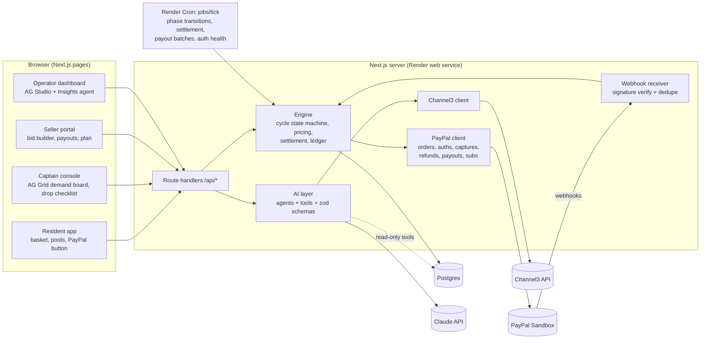
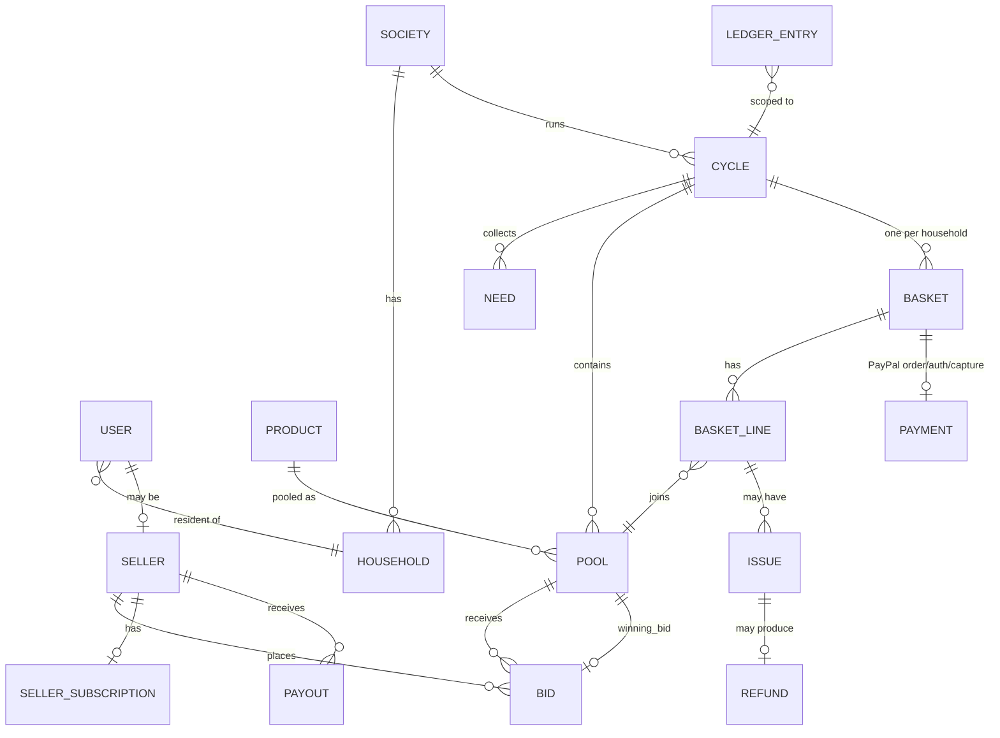
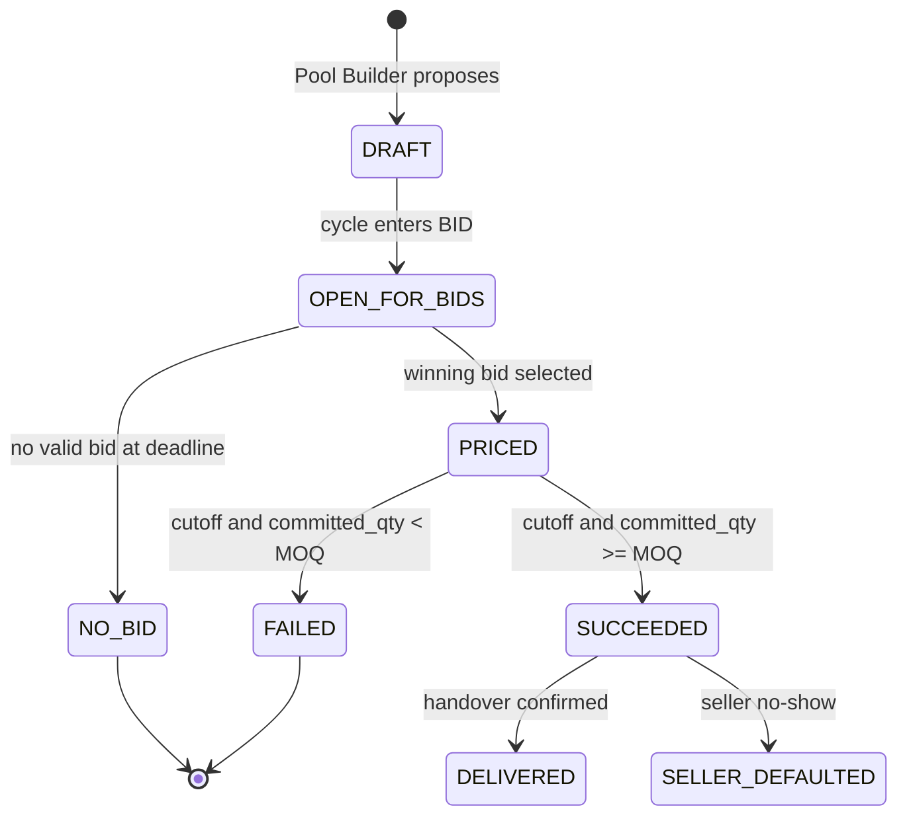
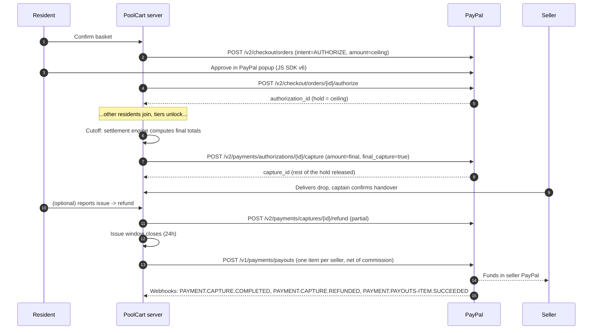

# PoolCart — System Architecture

> Status: **DRAFT for review**. Companion docs: [01-PRODUCT](01-PRODUCT.md), [03-POLICIES](03-POLICIES.md), [04-BUILD-PLAN](04-BUILD-PLAN.md).

## 1. Design principles

1. **AI proposes, the engine executes.** LLM output is always a schema-validated *proposal*. Only the deterministic settlement engine calls money-moving PayPal endpoints, and only on a state transition.
2. **One payment approval per resident per week.** One PayPal order (intent AUTHORIZE) per basket, and one capture at settlement.
3. **Everything idempotent.** `PayPal-Request-Id` on every POST, `sender_item_id` on payouts, deduplicated webhook event IDs, and state transitions guarded by row locks.
4. **Integer cents everywhere.** Money is stored as `bigint` cents with an explicit currency. No floats.
5. **Monolith first.** One Next.js app plus one Postgres database plus scheduled jobs. That's easy for judges to run, and it deploys to Render in one blueprint.

## 2. Tech stack

| Layer | Choice | Why |
|---|---|---|
| Web app and API | **Next.js 15 (App Router) + TypeScript** | Same base as the official PayPal + AG Studio boilerplate; server routes keep secrets server-side |
| UI | Tailwind + shadcn/ui; **AG Grid / AG Studio** for every data-heavy view | AG Grid sponsor prize; the demand board, bid comparison and dashboards are naturally grids |
| Database | **Postgres** (Render Postgres; Docker locally) + **Drizzle ORM** | Typed schema and migrations; row locks for state transitions |
| Jobs | **Render Cron Job** (every minute) running `jobs/tick.ts`; optional **Render Workflows** for fan-out (nudges, payouts) | Render sponsor; simple and reliable |
| LLM | **Claude API** (Anthropic SDK), `claude-opus-5-5` by default (set in `CLAUDE_MODEL`), with low effort for parsing and higher effort for agents | Strong tool use and vision (photo of a list) |
| Product data | **Channel3 API** (search, product details, retail price) | Canonical product identity plus savings baseline; Channel3 sponsor |
| Payments | **PayPal REST**: Orders v2, Payments v2 (authorizations, captures, refunds), Payouts v1, Billing Subscriptions v1, Webhooks v1 · **PayPal JS SDK v6** buttons on the client | Core requirement |
| Dev tooling | **APIMatic Context Plugin for PayPal** + PayPal AI Toolkit in Claude Code | APIMatic sponsor eligibility; faster integration |
| Hosting | **Render**: web service + Postgres + cron, defined in `render.yaml` | Hosted demo URL for judges |
| Auth | Session cookie + demo persona switcher (Resident / Captain / Seller / Operator) | Judges can try every role in one click without signing up |

## 3. Component diagram



The AI layer has **no** tool that calls PayPal write endpoints. It can only write *proposals* (draft pools, bid rankings, refund suggestions) into the database.

## 4. Repository layout

```
poolcart/
├─ app/
│  ├─ (resident)/            basket, pools, order status
│  ├─ (captain)/             society setup, demand board, bids, drop checklist
│  ├─ (seller)/              open pools, bid builder, payouts, subscription
│  ├─ (operator)/            AG Studio dashboard, seller approvals, ledger
│  ├─ demo/                  persona switcher + time-travel controls
│  └─ api/
│     ├─ ai/*                basket parse, pool build, bid rank, issue resolve, studio proxy
│     ├─ paypal/orders       create (AUTHORIZE), authorize-on-approve
│     ├─ paypal/subscriptions
│     ├─ webhooks/paypal
│     └─ cycles/[id]/advance (demo/time-travel; operator only)
├─ lib/
│  ├─ paypal/                client.ts (OAuth, retries, request-id), orders.ts, payments.ts,
│  │                         payouts.ts, subscriptions.ts, webhooks.ts
│  ├─ ai/                    claude.ts, agents/{basket,poolBuilder,bidAnalyst,pricing,nudger,issue,insights}.ts,
│  │                         schemas.ts (zod), prompts/
│  ├─ channel3/              client.ts
│  ├─ engine/                cycle.ts (state machine), pricing.ts, settlement.ts, payouts.ts,
│  │                         refunds.ts, ledger.ts
│  └─ db/                    schema.ts (drizzle), seed.ts
├─ jobs/tick.ts              runs every minute (Render cron)
├─ docs/                     these specs
├─ render.yaml
├─ .env.example
└─ LICENSE (MIT)
```

## 5. Data model

All money columns are `*_cents bigint` with a `currency char(3)` (always `USD` in the sandbox).



| Table | Key columns |
|---|---|
| `society` | id, name, drop_point, timezone, captain_user_ids[], schedule (jsonb phase offsets), auto_select_bids bool |
| `household` | id, society_id, unit_label (e.g. "B-1204"), opt_in_nudges bool |
| `user` | id, name, email, role (`resident`/`captain`/`seller`/`operator`), household_id? |
| `seller` | id, user_id, business_name, paypal_payout_email, status (`pending`/`approved`/`suspended`), license_ref, rating, strikes, plan (`starter`/`pro`/`partner`) |
| `seller_subscription` | seller_id, paypal_subscription_id, paypal_plan_id, status, current_period_end |
| `product` | id, title, brand (null = any), pack_size, unit, category, channel3_product_id, retail_ref_cents, image_url, flags (perishable, restricted) |
| `cycle` | id, society_id, week_label, phase (enum §6.1), phase_deadlines (jsonb), settled_at |
| `need` | id, cycle_id, household_id, raw_text, parsed (jsonb), product_id?, qty, brand_flexible bool, source (`text`/`photo`/`voice`/`autopilot`) |
| `pool` | id, cycle_id, product_id, status (enum §6.2), demand_estimate, committed_qty, winning_bid_id?, final_unit_cents?, ai_notes |
| `bid` | id, pool_id, seller_id, moq, max_capacity, tiers jsonb `[{min_qty, unit_cents}]` (sorted asc by min_qty; unit_cents strictly decreasing), delivery_window, valid_until, status (`submitted`/`won`/`lost`/`withdrawn`), ai_score, ai_rationale |
| `basket` | id, cycle_id, household_id, status (enum §6.3), ceiling_cents, captured_cents |
| `basket_line` | id, basket_id, pool_id, qty, ceiling_unit_cents, final_unit_cents?, status (`committed`/`won`/`released`/`refunded_partial`/`refunded_full`) |
| `payment` | id, basket_id, paypal_order_id, paypal_authorization_id, paypal_capture_id?, authorized_cents, captured_cents, status, honor_expires_at, auth_expires_at |
| `issue` | id, basket_line_id, type (`missing`/`damaged`/`wrong_item`/`quality`), qty_affected, photo_url, ai_assessment jsonb, decision, decided_by |
| `refund` | id, issue_id?, payment_id, paypal_refund_id, amount_cents, reason, charged_to (`seller`/`platform`) |
| `payout` | id, cycle_id, seller_id, gross_cents, commission_cents, refunds_cents, net_cents, paypal_batch_id, paypal_item_id, sender_item_id (unique), status |
| `ledger_entry` | id, cycle_id, account (enum §7), debit_cents, credit_cents, ref_type, ref_id, created_at |
| `webhook_event` | paypal_event_id (PK), type, received_at, processed_at, payload jsonb |
| `ai_decision` | id, agent, input_ref, output jsonb, model, accepted bool?, accepted_by, created_at (audit trail shown in UI) |

## 6. State machines

### 6.1 Cycle

```mermaid
stateDiagram-v2
  [*] --> COLLECT
  COLLECT --> BID: collect deadline (Pool Builder publishes pools)
  BID --> COMMIT: bid deadline (winners selected; pools with no bid -> NO_BID)
  COMMIT --> SETTLING: cutoff
  SETTLING --> FULFIL: all baskets captured or voided
  FULFIL --> RESOLVE: captain confirms handover
  RESOLVE --> PAYOUT: issue window closes (handover + 24h)
  PAYOUT --> CLOSED: all payouts SUCCESS
```

### 6.2 Pool



### 6.3 Basket / payment

```mermaid
stateDiagram-v2
  [*] --> DRAFT
  DRAFT --> AWAITING_APPROVAL: PayPal order created (intent AUTHORIZE, ceiling amount)
  AWAITING_APPROVAL --> AUTHORIZED: buyer approves; server calls /authorize
  AWAITING_APPROVAL --> DRAFT: buyer cancels
  AUTHORIZED --> WITHDRAWN: resident withdraws before cutoff (void)
  AUTHORIZED --> CAPTURED: settlement, >=1 line won (partial final capture)
  AUTHORIZED --> RELEASED: settlement, 0 lines won (void)
  CAPTURED --> PARTIALLY_REFUNDED: issue refund
  CAPTURED --> REFUNDED: all lines refunded
```



Changing a basket after authorization means voiding the current authorization and creating a new order. The UI calls this "re-confirm basket".

## 7. Money flow and ledger

**Platform as merchant of record (sandbox MVP).** Residents pay the PoolCart merchant account; PoolCart pays sellers with Payouts.



**Ledger accounts** (double entry: each event writes balanced rows):

| Event | Debit | Credit |
|---|---|---|
| Capture | `paypal_clearing` | `seller_payable` (line totals per seller) |
| Commission accrual (at payout) | `seller_payable` | `platform_revenue` |
| Refund charged to seller | `seller_payable` | `paypal_clearing` |
| Refund charged to platform (policy exceptions) | `platform_expense` | `paypal_clearing` |
| Payout | `seller_payable` | `paypal_clearing` |
| PayPal processing fee (from capture response `seller_receivable_breakdown`) | `platform_expense` | `paypal_clearing` |
| Subscription payment | `paypal_clearing` | `platform_revenue` |

The operator dashboard shows balances per account. The invariant `sum(debits) == sum(credits)` is checked in tests and shown as a green "Ledger balanced" badge.

## 8. Settlement algorithm (the core deterministic engine)

Runs once per cycle at cutoff, inside a DB transaction per pool, then per basket.

```text
for pool in cycle.pools where status == PRICED:
    lines = committed basket_lines in pool, ordered by authorized_at ASC   # first-committed wins capacity
    bid   = pool.winning_bid
    qty   = sum(lines.qty)
    if qty < bid.moq:
        pool.status = FAILED; lines.status = released; continue
    if qty > bid.max_capacity:
        keep lines in order until capacity reached; release the overflow (whole lines only)
        qty = kept quantity
    tier  = highest tier with tier.min_qty <= qty
    pool.final_unit_cents = tier.unit_cents
    pool.status = SUCCEEDED
    kept lines: status = won, final_unit_cents = tier.unit_cents

for basket in cycle.baskets where status == AUTHORIZED:
    total = sum(won_line.qty * won_line.final_unit_cents)
    assert total <= payment.authorized_cents          # always true: final <= ceiling
    if total == 0: void authorization  -> RELEASED
    else: capture(total, final_capture=true)  -> CAPTURED   # remainder of hold auto-released
    write ledger entries per seller
```

Edge handling:
- **Capture declined** (`INSTRUMENT_DECLINED` or authorization invalid): basket → `PAYMENT_FAILED`, lines removed. The pool is re-evaluated *once*. If it then drops below MOQ, the pool fails and all other baskets' lines for it are excluded *before* their capture. To make that possible, settlement processes captures **after** a dry-run pass that verifies each authorization's status with `GET /v2/payments/authorizations/{id}`.
- **Honor period:** cutoff is always ≤ 72h after the earliest authorization in the cycle (enforced by the schedule validator; see Policies §1).

## 9. PayPal integration map

| Capability | Endpoint(s) | Where used |
|---|---|---|
| OAuth | `POST /v1/oauth2/token` (cached until `expires_in` minus 60s) | `lib/paypal/client.ts` |
| Create order (AUTHORIZE) | `POST /v2/checkout/orders` | Basket confirm |
| Authorize order | `POST /v2/checkout/orders/{id}/authorize` | After buyer approves |
| Auth status / void | `GET` / `POST /v2/payments/authorizations/{id}[/void]` | Withdraw, failed pools, dry run |
| Capture | `POST /v2/payments/authorizations/{id}/capture` | Settlement |
| Refund | `POST /v2/payments/captures/{id}/refund` | Issue resolution, seller default |
| Payouts | `POST /v1/payments/payouts`, `GET /v1/payments/payouts/{batch_id}` | Seller settlement |
| Subscriptions | `POST /v1/catalogs/products`, `POST /v1/billing/plans`, `GET /v1/billing/subscriptions/{id}` + JS SDK subscription flow | Seller plans |
| Webhooks | `POST /v1/notifications/verify-webhook-signature` | `/api/webhooks/paypal` |
| Transactions (insights) | `GET /v1/reporting/transactions` | AG Studio dashboard (reconciliation view) |

Webhook events subscribed: `PAYMENT.AUTHORIZATION.CREATED`, `PAYMENT.AUTHORIZATION.VOIDED`, `PAYMENT.CAPTURE.COMPLETED`, `PAYMENT.CAPTURE.DENIED`, `PAYMENT.CAPTURE.REFUNDED`, `PAYMENT.PAYOUTSBATCH.SUCCESS`, `PAYMENT.PAYOUTS-ITEM.SUCCEEDED`, `PAYMENT.PAYOUTS-ITEM.FAILED`, `BILLING.SUBSCRIPTION.ACTIVATED`, `BILLING.SUBSCRIPTION.CANCELLED`, `BILLING.SUBSCRIPTION.PAYMENT.FAILED`.

**Production path (stated in the README, not built):** move to **PayPal Multiparty / Commerce Platform**, where each seller is an onboarded merchant, residents pay the seller directly, and PoolCart takes `platform_fees`. That removes the platform holding seller funds, but it needs PayPal partner approval, so the sandbox MVP uses merchant-of-record plus Payouts.

## 10. AI layer

**Model:** `claude-opus-5-5` for every agent (configurable through `CLAUDE_MODEL`). Cost and latency are tuned per route with `output_config.effort` (`low` for parsing and classification, `medium`/`high` for Bid Analyst and Insights). Server-side refusal fallbacks are on (`fallbacks: "default"`). Each agent returns JSON validated with zod; it retries once on a validation failure, then falls back to a manual UI.

| Agent | Tools it may call | Writes |
|---|---|---|
| Basket Assistant | `channel3.search`, `catalog.find_product`, `catalog.upsert_product` | `need` rows (status draft) |
| Pool Builder | `needs.list(cycle)`, `catalog.get`, `history.demand(product, society)` | `pool` rows (DRAFT) + `ai_notes` |
| Seller Pricing Copilot | `pool.get`, `product.retail_ref`, `history.tiers(product)` | Suggested tier sheet (UI only) |
| Bid Analyst | `pool.get`, `bids.list`, `seller.reputation`, `product.retail_ref` | `bid.ai_score`, `ai_rationale` |
| Momentum Nudger | `pools.near_tier(cycle)`, `household.history` (opted-in only) | `notification` drafts |
| Issue Resolver | `basket_line.get`, `policy.refund_limits`, vision on photo | `issue.ai_assessment` (proposal) |
| Insights Agent | AG Studio Studio Agent Framework + read-only SQL views | Dashboard widgets |

Every agent call writes an `ai_decision` row (input reference, output, model, accepted or not, by whom). The UI shows a "Why?" panel for every AI suggestion.

**Prompt-injection hygiene:** resident free text and seller bid notes are passed to the model as data, inside delimiters. Agents have no money tools. Bid Analyst output can't change a bid's numbers; it only scores the bid.

## 11. Security

- Secrets only in env vars (`.env.local` is git-ignored; Render env groups in production). The repo ships `.env.example`.
- Orders are created and captured server-side only; amounts are always recomputed on the server from DB state, never taken from the client.
- Webhook signature verification over the raw body; event-ID dedupe; return 200 fast and process asynchronously.
- Role checks on every route; sellers can only see aggregates for pools (no household data).
- Rate limit on `/api/ai/*` (per session) to protect the LLM key on the public demo.
- Demo-only routes (`/demo/*`, time travel) are enabled only when `DEMO_MODE=true`.

## 12. Environment variables

```
DATABASE_URL=
PAYPAL_ENV=sandbox
PAYPAL_CLIENT_ID=
PAYPAL_CLIENT_SECRET=
PAYPAL_WEBHOOK_ID=
PAYPAL_PLAN_ID_PRO=
PAYPAL_PLAN_ID_PARTNER=
ANTHROPIC_API_KEY=
CHANNEL3_API_KEY=
AG_STUDIO_LICENSE=
APP_BASE_URL=
DEMO_MODE=true
SESSION_SECRET=
```

## 13. Deployment (Render blueprint)

- `web`: Next.js (`npm run build && npm start`)
- `cron`: `node jobs/tick.js`, every minute
- `postgres`: Render Postgres (free tier OK for the demo)
- Seed script creates the "Maple Heights" society (40 households), 3 sellers, ~25 products with Channel3 references, and one cycle in COLLECT.

## 14. Demo mode

- **Persona switcher:** one click to become Resident (B-1204), Captain, Seller (FreshFarm Wholesale) or Operator.
- **Time travel:** an "Advance phase" button calls the same `engine.cycle.advance()` the cron uses, so the demo runs the real code path.
- **Crowd simulator:** "Add 12 simulated neighbours" creates baskets for seeded households so the tier drop is visible live. A PayPal wallet approval needs a buyer login, so a server can't approve on a buyer's behalf. Simulated baskets therefore use one of these, decided in the Day-0 spike:
  1. **Preferred:** server-side Orders v2 with `payment_source.card` and PayPal's sandbox test card numbers (needs card processing enabled on the sandbox app). These are real sandbox authorizations, captures and voids.
  2. **Fallback:** baskets flagged `simulated=true` count toward pool quantity but skip PayPal calls, and show a "simulated" badge everywhere. The presenter's own basket always goes through the real PayPal popup.
