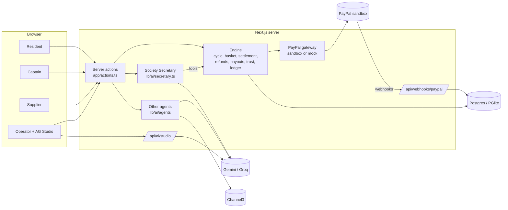
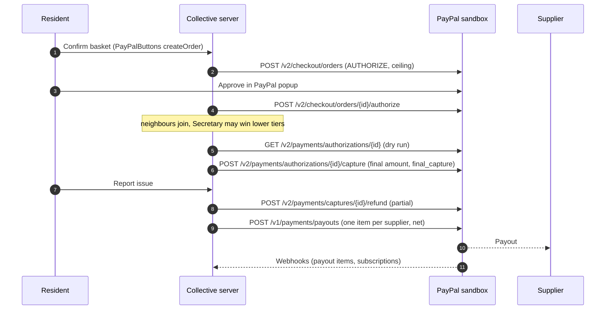

# Collective: architecture

Companion docs: [01-PRODUCT](01-PRODUCT.md), [03-POLICIES](03-POLICIES.md), [04-BUILD-PLAN](04-BUILD-PLAN.md).

## Design principles

1. **AI proposes, code moves money.** Captures, voids and payouts run only in the settlement and payout engine. The one money tool an agent has is `issue_refund`, which calls `agentRefund` in `lib/engine/refunds.ts`; code checks the limits before PayPal is called.
2. **One approval per resident per week.** One PayPal order with `intent=AUTHORIZE` per basket, one final capture at cutoff.
3. **Retry-safe.** `PayPal-Request-Id` on every POST (fixed ids for authorize, capture, void and refund), guarded phase transitions, idempotent settlement and payouts, de-duplicated webhook event ids.
4. **Integer cents.** All money is stored as integer cents in USD.
5. **One app.** One Next.js app and one Postgres database. Locally the database is PGlite, so there is nothing to install.

## Stack

| Layer | Choice |
|---|---|
| Web app | Next.js 16 (App Router), React 19, TypeScript; all mutations are server actions in `app/actions.ts` |
| UI | Tailwind CSS 4; AG Grid for the demand board, ledger and AI log; AG Studio for the analytics dashboard |
| Database | Postgres through Drizzle ORM. `DATABASE_URL` set: node-postgres (Render). Unset: embedded PGlite in `./.data`. Migrations run on first connection. |
| LLM | Free-tier Gemini (`gemini-2.5-flash`, `GEMINI_MODEL`) then Groq (`llama-3.3-70b-versatile`, `GROQ_MODEL`; vision `GROQ_VISION_MODEL`) over their OpenAI-compatible APIs with `fetch`; JSON replies validated with zod |
| Product data | Channel3 search for items the catalog doesn't know (identity and retail reference price) |
| Payments | PayPal sandbox. Orders v2 and Payments v2 through PayPal's Server SDK (`@paypal/paypal-server-sdk`, generated by APIMatic); Payouts v1, Billing Plans and Subscriptions v1 and webhook signature verification over REST. Client: `@paypal/react-paypal-js` `PayPalButtons`. |
| Hosting | Render blueprint (`render.yaml`): one web service and one Postgres database |
| Tests | Vitest on in-memory PGlite with the PayPal mock and rule-based AI |

## Components



## Repository layout

```
app/
  page.tsx                 persona picker
  resident/ captain/ seller/ ops/ ops/dashboard/
  _components/             header, cycle bar, guided demo bar, grids, Secretary panel
  actions.ts               every mutation, with a role check
  api/ai/studio/route.ts   AG Studio LLM turns -> Gemini / Groq
  api/webhooks/paypal/route.ts
lib/
  ai/llm.ts                Gemini -> Groq client, JSON calls, tool loop, rules fallback, hourly budget, AI_MODE
  ai/secretary.ts          Society Secretary (tool runner + rules playbook)
  ai/agents/               basket.ts, sellerSide.ts (Pricing Copilot, Bid Analyst), issue.ts
  engine/                  cycle, basket, pricing, settlement, refunds, payouts, negotiation,
                           trust, ledger, demo (simulators, reset, history), tour (guided demo)
  paypal/gateway.ts        PayPal Server SDK + REST client and in-process mock behind one interface
  paypal/subscriptions.ts  supplier plans
  db/                      schema.ts, seed.ts, index.ts (driver choice, migrate, seed, mock restore), migrations/
  channel3.ts, queries.ts, dashboard-data.ts, session.ts
spikes/                    standalone sandbox scripts used to de-risk PayPal and Channel3
tests/                     Vitest suites
```

## Data model

All money columns are integer cents (USD).

| Table | Purpose and key columns |
|---|---|
| `society`, `household` | The building, its drop point, `auto_select_bids`, `max_qty_per_line` (10); flats by unit label |
| `app_user` | Personas and other users: role, household, `is_persona` |
| `seller` | Business name, payout email, status (`pending`/`approved`/`suspended`), plan, subscription id and status, `balance_cents` (negative = owed) |
| `product` | Catalog: pack size, `retail_ref_cents`, `retail_source` (`seed`/`channel3`), perishable and restricted flags |
| `cycle` | Week label, phase, display deadlines, timestamps for commit, settle, handover, close |
| `need` | A household's requested product and quantity, brand flexibility, source (`text`/`photo`/`simulated`) |
| `pool` | One per cycle and product: status, demand, winning bid, final unit price, kept quantity, AI notes and recommendation |
| `bid` | MOQ, capacity, tiers `[{minQty, unitCents}]`, delivery window, status, `commission_bps` fixed at win, code score, AI rationale and flags |
| `basket`, `basket_line` | One basket per household per cycle; lines with ceiling and final unit price, refunded cents, status |
| `payment` | PayPal order, authorization and capture ids, mode (`sandbox`/`mock`), method (`paypal_wallet`/`card`), authorized, captured, PayPal fee |
| `issue`, `refund` | Reported problem, AI assessment, decision, refund amount; refund rows charged to the seller |
| `payout` | Per seller per cycle: gross, commission, refunds, carried balance, net, unique `sender_item_id`, batch id, status |
| `ledger_entry` | Double-entry rows grouped by `txn_id` |
| `trust_event` | Verified facts for suppliers and households: kind, score, weight, `voided` |
| `ai_decision` | Every agent run: agent, input reference, output, model or `rules` |
| `webhook_event` | PayPal event id (primary key), type, payload, processed time |
| `activity` | Human-readable feed shown on every page |

## State machines

### Cycle

```mermaid
stateDiagram-v2
  [*] --> COLLECT
  COLLECT --> BID: close collection (one pool per product with demand)
  BID --> COMMIT: close bidding (winners picked or auto-selected; others NO_BID; baskets prefilled)
  COMMIT --> FULFIL: cutoff (settlement; reverts to COMMIT if it throws)
  FULFIL --> RESOLVE: captain confirms handover
  RESOLVE --> CLOSED: no pending issues; payouts sent
```



Each transition updates the row only `where phase = <current>`, so a double click is rejected. Transitions are triggered by the captain or demo controls (`advancePhase`) or the guided demo. Nothing runs on a timer.

### Pool

`OPEN_FOR_BIDS` (created at close of collection) → `PRICED` or `NO_BID` → `SUCCEEDED` or `FAILED` at cutoff → `DELIVERED` at handover. The schema also has `DRAFT` and `SELLER_DEFAULTED`; neither is used yet.

### Basket

```mermaid
stateDiagram-v2
  [*] --> DRAFT
  DRAFT --> AWAITING_APPROVAL: PayPal order created (ceiling amount)
  AWAITING_APPROVAL --> AUTHORIZED: buyer approves; server authorizes
  AWAITING_APPROVAL --> DRAFT: declined or edited
  DRAFT --> AUTHORIZED: test-card hold (server-side)
  AUTHORIZED --> DRAFT: basket edited (hold voided)
  AUTHORIZED --> WITHDRAWN: resident withdraws (hold voided)
  WITHDRAWN --> DRAFT: basket edited
  AUTHORIZED --> CAPTURED: cutoff, at least one line won
  AUTHORIZED --> RELEASED: cutoff, nothing won (void)
  AUTHORIZED --> PAYMENT_FAILED: hold invalid or capture failed
  CAPTURED --> PARTIALLY_REFUNDED: refund
  PARTIALLY_REFUNDED --> REFUNDED: refunds reach the captured total
```



Baskets still in `DRAFT`, `AWAITING_APPROVAL` or `WITHDRAWN` at cutoff keep their status; their lines are released and nothing is charged.

## Settlement

`settleCycle` in `lib/engine/settlement.ts` is the only code that captures or voids resident holds.

1. **Unconfirmed baskets:** lines released; pending orders marked `SUPERSEDED`.
2. **Dry run:** `GET` each authorization. Anything not `CREATED` or `PENDING` makes that basket `PAYMENT_FAILED` and releases its lines before any pool is priced.
3. **Pools:** for each `PRICED` pool, `settlePool` (pure, in `pricing.ts`) orders committed lines by hold time, fails the pool below MOQ, keeps whole lines up to capacity, and prices every kept line at the tier the kept quantity reached.
4. **Baskets:** for each valid hold, total = sum of won lines. Zero: void. Otherwise check `total <= authorized`, capture with `final_capture=true`, then record the payment, basket status, ledger rows, PayPal fee and a `commitment_kept` trust event in one database transaction.

Robustness (covered by `tests/settlement.test.ts`):

- **Per-basket isolation.** A failed void is logged and skipped (PayPal expires the hold). A failed capture marks only that basket `PAYMENT_FAILED`, releases its lines and records `payment_failed`. Other baskets still settle.
- **Phase revert.** `advance` moves the cycle to `FULFIL` first as a lock; if settlement throws, it moves back to `COMMIT` so cutoff can be retried.
- **Idempotent re-runs.** Only `PRICED` pools and baskets not yet captured are selected, and won lines are read back from the database, so a second run charges nobody twice.

Not implemented: when a capture fails, other baskets in the same pool are not re-priced. That basket's lines are released, and the pool keeps the price it reached.

## Money flow

Collective is the merchant of record in the sandbox. Residents pay Collective's PayPal account; Collective pays suppliers with Payouts.



### Ledger

`post()` in `lib/engine/ledger.ts` throws if a transaction's debits and credits differ.

| Event | Debit | Credit |
|---|---|---|
| Capture | `paypal_clearing` | `seller_payable` (per supplier) |
| PayPal fee (from the capture response) | `platform_expense` | `paypal_clearing` |
| Refund (always charged to the supplier) | `seller_payable` | `paypal_clearing` |
| Commission (at payout) | `seller_payable` | `platform_revenue` |
| Payout | `seller_payable` | `paypal_clearing` |
| Supplier plan activation (first month) | `paypal_clearing` | `platform_revenue` |

The operator page shows whether total debits equal total credits.

## PayPal integration map

Rows marked SDK go through `OrdersController` or `PaymentsController` of the PayPal Server SDK, which sends the same requests with typed bodies, its own OAuth token cache, and retries on 429 and 5xx (safe because every POST carries a `PayPal-Request-Id`). SDK errors are mapped to `PayPalError` with PayPal's issue code.

| Capability | Endpoint | Where |
|---|---|---|
| OAuth | `POST /v1/oauth2/token`: the SDK manages its own token; the REST helper caches one until 60 s before expiry | `gateway.ts` |
| Wallet order (SDK) | `POST /v2/checkout/orders` (`AUTHORIZE`, `payment_source.paypal`) | `startCheckout` |
| Authorize (SDK) | `POST /v2/checkout/orders/{id}/authorize` | `completeCheckout`, card holds |
| Test-card hold (SDK) | `POST /v2/checkout/orders` with `payment_source.card` (PayPal's published sandbox card) | `cardCheckout`: simulated neighbours, the guided demo, and the "Hold with a PayPal sandbox test card" button |
| Get authorization (SDK) | `GET /v2/payments/authorizations/{id}` | Settlement dry run; "Check this with PayPal" on the receipt (`verifyPaymentAction`) |
| Capture (SDK) | `POST /v2/payments/authorizations/{id}/capture` | Settlement |
| Void (SDK) | `POST /v2/payments/authorizations/{id}/void` | Edit, withdraw, nothing won |
| Refund (SDK) | `POST /v2/payments/captures/{id}/refund` | Issue refunds |
| Payouts | `POST /v1/payments/payouts`, `GET /v1/payments/payouts/{id}` | Payouts; payout status refresh (`refreshPayoutsAction`) |
| Subscriptions | `POST /v1/catalogs/products`, `POST /v1/billing/plans`, `GET /v1/billing/subscriptions/{id}` | Supplier plans; the server verifies the subscription before granting it |
| Webhooks | `POST /v1/notifications/verify-webhook-signature` | `/api/webhooks/paypal` |

Webhooks: payout item failed, unclaimed and succeeded events update payout status; subscription cancelled, suspended and payment-failed events update the supplier's subscription status. Other events are stored and marked processed, because captures and refunds are already recorded from API responses.

Not used: `/v1/reporting/transactions`, PayPal Multiparty, Vault, and the PayPal Agent Toolkit at runtime.

**Production path (not built):** PayPal Multiparty, with suppliers onboarded as merchants and commission taken as `platform_fees`. That needs partner approval.

## AI layer

`runAgent` in `lib/ai/llm.ts` runs the AI path when enabled and falls back to rules on any error or invalid output. Each call tries Gemini, then Groq on any failure (rate limit, server error, bad key, timeout); when both fail the agent's rules path runs. Every run writes an `ai_decision` row with the `provider:model` that answered. AI is enabled only when `GEMINI_API_KEY` or `GROQ_API_KEY` is set, `AI_MODE` is not `rules`, and the hourly budget (`AI_CALLS_PER_HOUR`, default 300) is not used up.

### Society Secretary

OpenAI-style tool calling through `llmToolLoop` in `lib/ai/llm.ts` (at most 8 model turns). Each tool input is checked with zod before the tool runs; invalid input is reported back to the model, not executed. Tools are scoped by who is asking:

| Tool | Available to | Does |
|---|---|---|
| `get_status` | everyone | Pools, supplier and trust, funded holds, price now, next break, retail |
| `get_my_basket` | resident | The asker's own basket |
| `get_my_record` | supplier | The asker's own trust score and record |
| `get_supplier_record` | system, captain | Any supplier's score and record |
| `get_issue` | system, captain | Issue, AI assessment and the refund limits that apply |
| `issue_refund` | system, captain | `agentRefund`: refuses over $10, over the line's charged amount, a second refund for the issue, or a 4th automatic refund for the household in 30 days |
| `escalate_to_captain` | system, captain | Logs a handover to the captain; the issue stays pending |
| `request_better_price` | system, captain | `fundedAsk` for one pool |

Capture, void and payout are not tools. If a tool already acted and the run then fails, the Secretary returns what it did instead of letting the rules playbook act again. Without a key, the playbook refunds plausible claims within the limits and escalates the rest, asks the three pools with the most money held for better prices, and answers questions with plain facts.

### Other agents

| Agent | File | Output | Rules fallback |
|---|---|---|---|
| Basket Assistant | `agents/basket.ts` | Catalog lines from text or photo; Channel3 for unknown items | Line-by-line keyword matching (no photos) |
| Pool Builder | `engine/cycle.ts` | Seller notes, merge suggestions (text only) | Counts-based notes |
| Pricing Copilot | `agents/sellerSide.ts` | Tier sheet, checked by `validateTiers` | Formula from demand and retail |
| Bid Analyst | `agents/sellerSide.ts` | Rationale and extra flags; `scoreBid` sets the score | Template rationale |
| Issue Resolver | `agents/issue.ts` | Classification and affected quantity; code computes the refund | Trusts the report, medium confidence for missing items |
| AG Studio analyst | `app/api/ai/studio/route.ts` | Model turns for AG Studio's own agents | Disabled (503) |

Resident and supplier free text is wrapped with `asData` and treated as data in every prompt.

## Modes and switches

| Switch | Effect |
|---|---|
| No PayPal keys, or `PAYPAL_MODE=mock` | In-process PayPal mock with the same rules (capture at most the hold, refund at most the capture, unique payout batches). After a restart, `restoreMockPayPal` rebuilds mock orders, holds and captures from the `payment` table so a week in progress still settles. |
| No Gemini or Groq key, or `AI_MODE=rules` | Rule-based fallbacks everywhere; photo reading and the AG Studio analyst are off |
| `AI_CALLS_PER_HOUR` | Global hourly cap on AI calls (default 300; `render.yaml` sets 200) |
| `DEMO_MODE` (on unless `false`) | Persona switching, demo clock, simulators, reset and guided demo |
| No `CHANNEL3_API_KEY` | Local catalog only |

The header shows the PayPal and AI modes.

## Security

- Secrets live in environment variables; the repo ships `.env.example`. The PayPal base URL is the sandbox only.
- Amounts are always computed on the server from database state.
- Webhooks are verified against PayPal before processing and de-duplicated by event id. Without `PAYPAL_WEBHOOK_ID` they are rejected.
- Server actions check the persona's role. The persona cookie is unsigned, which is acceptable only for a demo.
- Supplier pages and the supplier's Secretary tools read pool totals only, never household data.
- No payer details are stored, only PayPal ids and amounts.

## Environment variables

`DATABASE_URL`, `PGLITE_DIR`, `PAYPAL_CLIENT_ID`, `PAYPAL_CLIENT_SECRET`, `PAYPAL_MODE`, `PAYPAL_WEBHOOK_ID`, `PAYPAL_SANDBOX_PERSONAL_EMAIL` (receives demo payouts), `PAYPAL_PLAN_ID_PRO`, `PAYPAL_PLAN_ID_PARTNER` (otherwise plans are created on first use), `GEMINI_API_KEY`, `GROQ_API_KEY`, `GEMINI_MODEL`, `GROQ_MODEL`, `GROQ_VISION_MODEL`, `AI_MODE`, `AI_CALLS_PER_HOUR`, `CHANNEL3_API_KEY`, `AG_STUDIO_LICENSE`, `DEMO_MODE`, `APP_BASE_URL`.

## Deployment

`render.yaml` defines a Node web service (`npm ci && npm run build`, `npm start`) and a Render Postgres database. There is no cron job or worker. On first request the app migrates the database and, if it is empty, seeds Gulmohar Residency and runs the seeded history.

## Demo support

- **Seeded history** (`seedHistory` in `lib/engine/demo.ts`): weeks 43 to 45 run through the real engine (`advance`, bids, simulated holds, settlement, issues, payouts) with keys blanked, so they use mock PayPal and rule-based AI and cost nothing. Their payments are stored with mode `mock`.
- **Simulators:** competing supplier bids; simulated neighbours who place card holds (real sandbox holds with the test card when keys are set).
- **Guided demo** (`lib/engine/tour.ts`): 12 steps worked out from database state, each running the same engine code as the normal buttons.
- **Live refresh:** during Confirm and pay, the captain page and a resident page with a hold in place refresh every 4 seconds.
- **Reset** wipes and re-seeds everything, including history.
